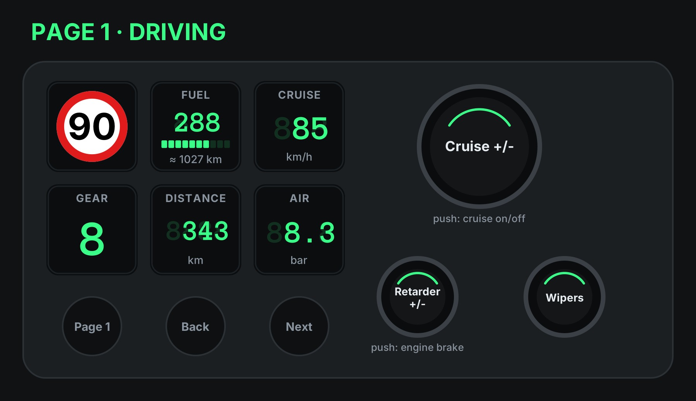
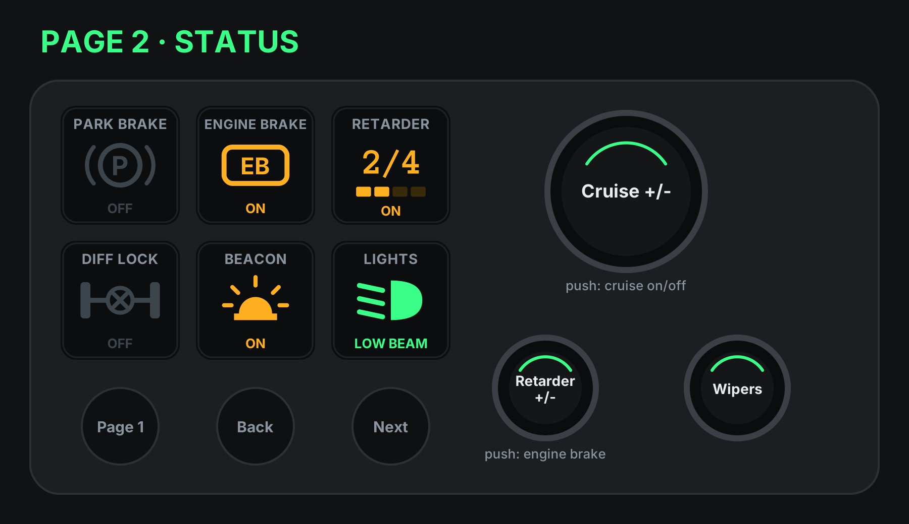
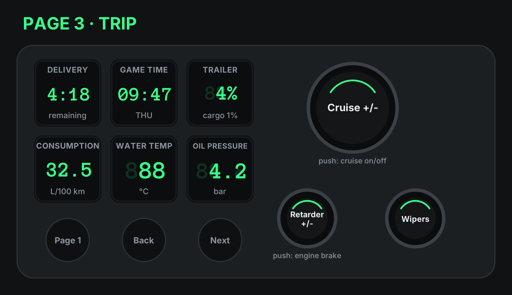
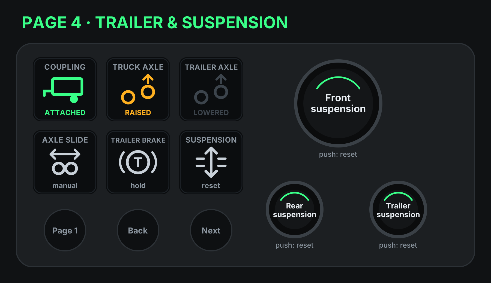
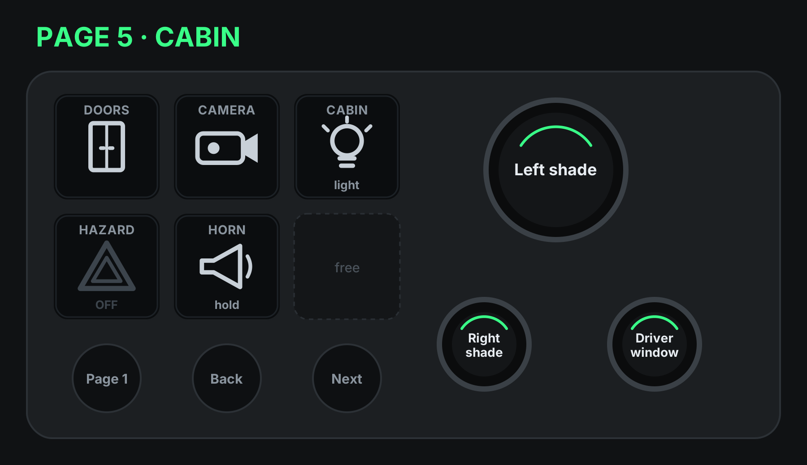

<div align="center">

# 🚛 ETS2 Dash

**Live telemetry and direct truck controls for Euro Truck Simulator 2 & American Truck Simulator on the Ajazz AKP03E**

[](https://github.com/cherry-terry/ajazz-ets2-dash/archive/refs/heads/main.zip)
[](ETS2Dash-Guide.pdf)




</div>

---

## ✨ Features

- 📊 **Live data on 6 display keys**: speed limit, fuel and range, gear, cruise speed, air and oil pressure, water temperature, delivery time and more, updated 10 times per second.
- 🎮 **No key bindings needed**: the plugin drives the game through the official SCS SDK (42 functions), so you don't touch the game's control settings and don't need a keyboard.
- 🟢 **Keys show the real state**: parking brake, beacon, diff lock, lights, coupling and lift axles light up exactly as they are in the game, and a press toggles them.
- 🎛️ **Encoders for smooth control**: cruise speed, retarder, wipers, suspension, sun shades and windows.
- 🔒 **Local only**: both parts talk over `127.0.0.1`, no background app and no internet.

## 🖼️ Pages

Five ready-made pages. Every layout is only a suggestion: any action can go on any key.

<table>
  <tr>
    <td align="center"><a href="#1--driving"><br><b>1 · Driving</b></a></td>
    <td align="center"><a href="#2--status"><br><b>2 · Status</b></a></td>
    <td align="center"><a href="#3--trip"><br><b>3 · Trip</b></a></td>
  </tr>
  <tr>
    <td align="center"><a href="#4--trailer--suspension"><br><b>4 · Trailer & Suspension</b></a></td>
    <td align="center"><a href="#5--cabin"><br><b>5 · Cabin</b></a></td>
    <td align="center"><a href="ETS2Dash-Guide.pdf"><br>📘<br><b>Full guide (PDF)</b><br><sub>installation and every key explained</sub></a></td>
  </tr>
</table>

## 📦 Installation

> [!IMPORTANT]
> Close the game and Stream Dock completely (including the tray icon) before copying files.

1. **Game plugin.** Copy `1_game_plugin/ets2dash.dll` to
   `...\steamapps\common\Euro Truck Simulator 2\bin\win_x64\plugins\`
   Create the `plugins` folder if it doesn't exist. For ATS use the ATS folder.
   <sub>Find the game folder: Steam → right-click the game → Manage → Browse local files.</sub>
2. **Stream Dock plugin.** Copy the `2_streamdock_plugin/com.diy.ets2dash.sdPlugin` folder to
   `%APPDATA%\HotSpot\StreamDock\plugins\`
   When updating, delete the old `com.diy.ets2dash.sdPlugin` folder first.
3. **Start Stream Dock.** The **ETS2 Dash** category appears in the action list: 29 key actions, 11 knob actions.
4. **Create 5 pages** with the `+` button under the device picture and drag the actions as shown below.
5. **Physical buttons.** Assign Stream Dock's built-in page switching to the three round buttons on every page: left → page 1, middle → previous, right → next.
6. **Start the game** and click **OK** in the *Advanced SDK features* dialog. Get into the truck and the keys come alive within a second.

### ✅ Check that it works

| You see | Meaning |
|---|---|
| `no game` on the keys | Stream Dock plugin runs, but no data from the game. The game isn't running or the DLL is in the wrong folder. |
| Values are updating | Telemetry works. |
| Pressing **Parking Brake** applies it and the key turns red | Controls work. |

## 🎛️ Key and encoder reference

Encoder direction is the same everywhere: **clockwise** — up / more / close, **counter-clockwise** — down / less / open.

### 1 · Driving


<details>
<summary><b>Keys and encoders</b></summary>

| Key | Shows | Press |
|---|---|---|
| Speed Limit | Road sign with the current limit (grey ring — no limit) | — |
| Fuel | Litres, fill gauge, range in km. Red when low | — |
| Cruise Control | Set cruise speed or OFF | Cruise on/off |
| Gear | Gear number, N or R1/R2 | — |
| Distance to Destination | Km to the end of the route / delivery point | — |
| Air Pressure | Brake air pressure, bar. Amber — warning, red — dangerously low | — |

| Encoder | Rotate | Push |
|---|---|---|
| Cruise +/- | Cruise speed, one step per click | Cruise on/off |
| Retarder +/- | Retarder level | Toggle engine brake |
| Wipers | Wiper mode forward/back | — |

</details>

### 2 · Status


<details>
<summary><b>Keys and encoders</b></summary>

| Key | Shows | Press |
|---|---|---|
| Parking Brake | Red (P) when applied | Apply/release |
| Engine Brake | Amber when on | On/off |
| Retarder | Level (e.g. 2/4) and segment bar | +1 level, off after max |
| Differential Lock | Amber when locked | Lock/unlock |
| Beacon | Amber when on | On/off |
| Lights | Off, parking, low beam (green), high beam (blue) | Short — next mode, hold > 0.5 s — high beam |

Encoders: same as page 1.

</details>

### 3 · Trip


<details>
<summary><b>Keys and encoders</b></summary>

Display only, no press actions.

| Key | Shows |
|---|---|
| Delivery Time | Time left until the deadline. Amber — under an hour, red with minus — late |
| Game Time | In-game clock and weekday |
| Trailer Damage | Highest trailer wear %, cargo damage below |
| Fuel Consumption | Average L/100 km |
| Water Temperature | Coolant °C. Red when overheating |
| Oil Pressure | Bar. Red on warning |

Encoders: same as page 1.

</details>

### 4 · Trailer & Suspension


<details>
<summary><b>Keys and encoders</b></summary>

| Key | Shows | Press |
|---|---|---|
| Trailer Coupling | ATTACHED (green) / DETACHED | Attach/detach |
| Truck Lift Axle | RAISED (amber) / LOWERED | Raise/lower |
| Trailer Lift Axle | RAISED (amber) / LOWERED | Raise/lower |
| Trailer Axle Slide | Command key | Manual axle adjustment |
| Trailer Brake | Green while active | Brakes the trailer while held |
| Reset Suspension | Command key | Default height |

| Encoder | Rotate | Push |
|---|---|---|
| Front Suspension | Truck front up/down (moves while you turn) | Reset |
| Rear Suspension | Truck rear up/down | Reset |
| Trailer Suspension | Trailer up/down | Reset |

</details>

### 5 · Cabin


<details>
<summary><b>Keys and encoders</b></summary>

The game doesn't report these states, so command keys flash green on press (Hazard Lights show the real state).

| Key | Shows | Press |
|---|---|---|
| Doors | Command key | Open/close doors (bus) |
| Parking Camera | Command key | Camera mode |
| Cabin Light | Command key | On/off |
| Hazard Lights | Red triangle when on | On/off |
| Horn | Green while sounding | Sounds while held |
| *(free)* | Any action you like | — |

| Encoder | Rotate |
|---|---|
| Left Sun Shade | Driver's shade up/down |
| Right Sun Shade | Passenger's shade up/down |
| Driver Window | Close/open (moves while you turn) |

</details>

### Spare encoder actions

| Encoder | Rotate | Push |
|---|---|---|
| Passenger Window | Close/open right window | — |
| Trailer Axle Slide | Axle forward/back | Manual slide mode |

### 🎨 Key colours

| Colour | Meaning |
|---|---|
| 🟢 Green | Normal / on (lights, coupling) |
| 🟠 Amber | Something worth noticing (beacon, diff lock, retarder) or a warning |
| 🔴 Red | Parking brake, hazards, low fuel, late delivery, critical pressure/temperature |
| 🔵 Blue | High beam |
| ⚪ Grey | Off / no data |

## 🛠️ Troubleshooting

| Problem | Fix |
|---|---|
| No **ETS2 Dash** category in Stream Dock | Plugin is in the wrong folder. Put it next to the other Stream Dock plugins and fully restart Stream Dock. |
| All keys show `no game` | The game doesn't see the DLL. Check `bin\win_x64\plugins`. No *Advanced SDK features* dialog at start-up = wrong place. |
| Values show, presses do nothing | Open `Documents\Euro Truck Simulator 2\game.log.txt`, look for `[ets2dash]` lines. There should be `input device ready`. |
| Keys disappeared after an update | Drag the actions from the ETS2 Dash category onto the keys again. |
| Encoder works only sometimes | Controls work only while the game window is active and you are in the truck. |

Stream Dock plugin log: `...\com.diy.ets2dash.sdPlugin\plugin\log\plugin.log`

## ⚙️ Technical details

| | |
|---|---|
| Telemetry (game → Stream Dock) | UDP `127.0.0.1:39421`, 10 Hz |
| Commands (Stream Dock → game) | UDP `127.0.0.1:39422` |
| In-game control | SCS Input SDK semantical device "ETS2 Dash", 42 functions from `controls.sii` |
| Requirements | Windows 10/11, 64-bit ETS2 or ATS, Stream Dock with built-in Node.js |
| Units | km/h, km, L, bar, °C |

### Building the DLL

```bash
# MinGW
x86_64-w64-mingw32-g++ -O2 -shared -Isource/scs_sdk source/ets2dash.cpp -o ets2dash.dll -lws2_32 -static
```

Visual Studio: x64 DLL project, include path `source/scs_sdk`, link `ws2_32.lib`.

## 📄 License

[MIT](LICENSE). Uses the SCS Software Telemetry & Input SDK. Not affiliated with SCS Software or Ajazz.
